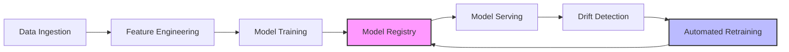

# Pipeline Architecture Diagrams

This directory contains architecture diagrams for the MLOps pipeline.

## pipeline_architecture.png

This image should represent the end-to-end MLOps pipeline with the following components:

1. **Data Ingestion** → Data from Oxford RobotCar dataset (INS and video data)
2. **Feature Engineering** → Extracting features with sliding windows
3. **Model Training** → Training ML models with aligned multimodal data
4. **Model Registry** → Storing and versioning models
5. **Drift Detection** → Monitoring for data distribution changes
6. **Automated Retraining** → Trigger based on drift detection
7. **Model Serving** → REST API for predictions

The diagram should show the flow between components and highlight the closed-loop nature of the pipeline with drift detection feeding back to retraining.

Recommended tools for creating the diagram:
- draw.io
- Lucidchart
- Mermaid
- Microsoft Visio

Example of a text-based representation in Mermaid:

Please replace this README with the actual diagram image. 